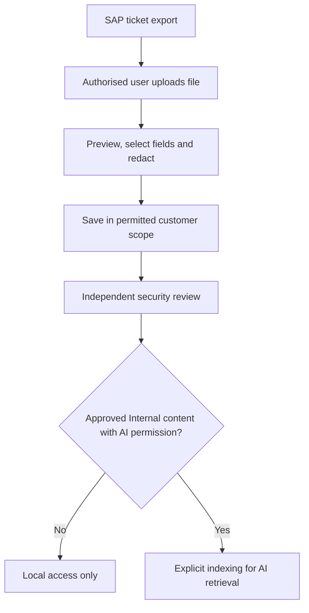
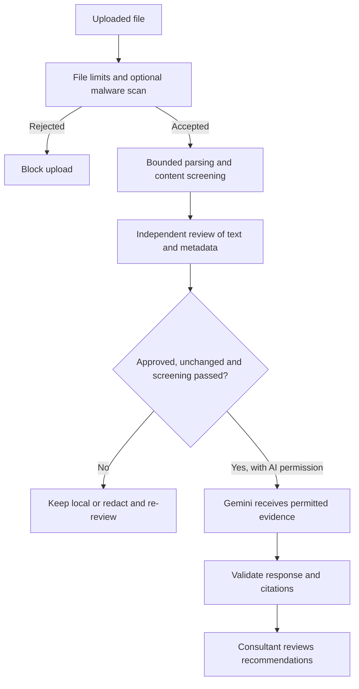

# SAP ingestion and file/prompt-injection controls

These simplified diagrams describe the current local implementation. SAP ingestion uses exports; a live SAP connector is not configured. Malware scanning requires an installed/configured ClamAV scanner.

## 1. SAP ticket ingestion

Saving does not contact Gemini. Indexing also requires current approval and passing content screening. Unstructured AI ticket extraction is a separate optional intake action requiring screening and explicit disclosure confirmation.

## 2. File upload and prompt-injection safeguards

Malformed files or parser limits can also block an upload. Screening does not guarantee detection of prompt injection. Authorisation remains enforced by application code, and AI output cannot grant approval or execute a fix. Invalid responses/citations are rejected rather than saved as a new valid analysis.
